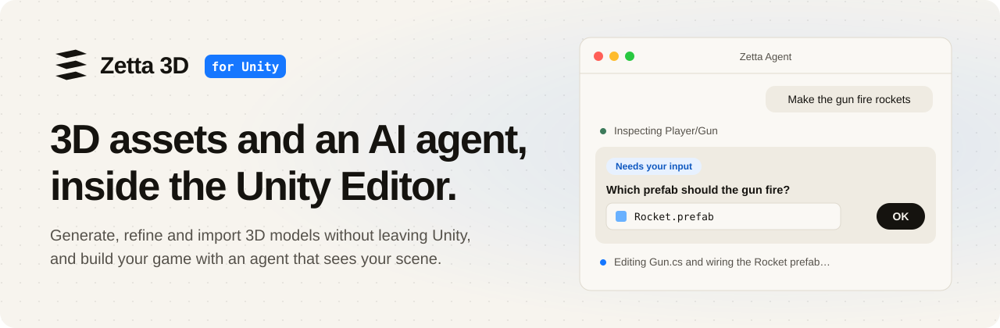
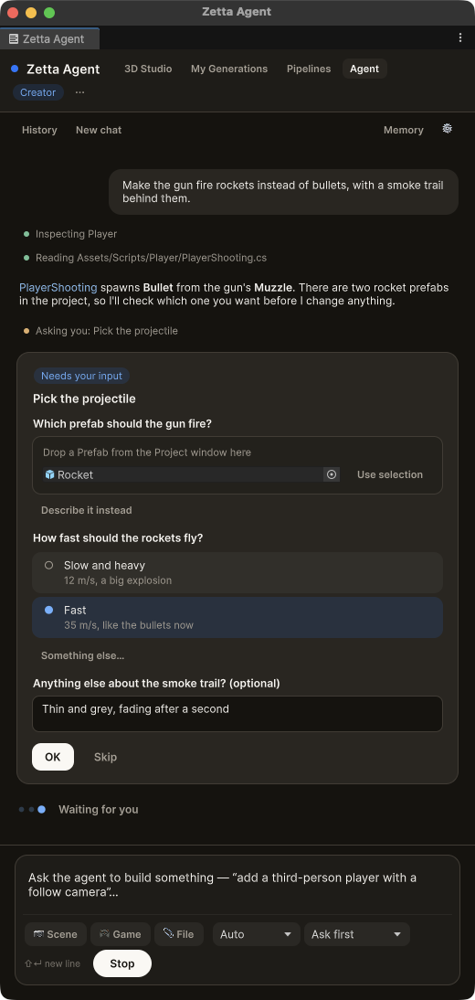
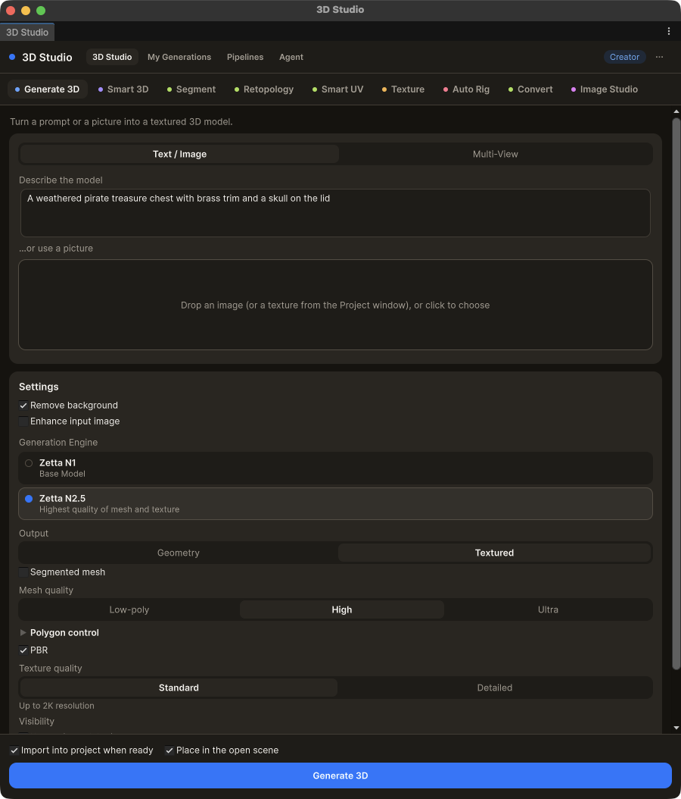
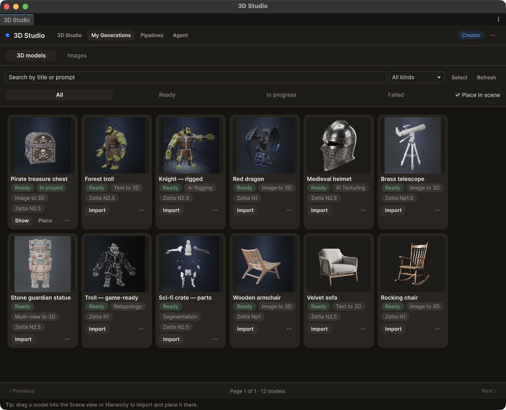
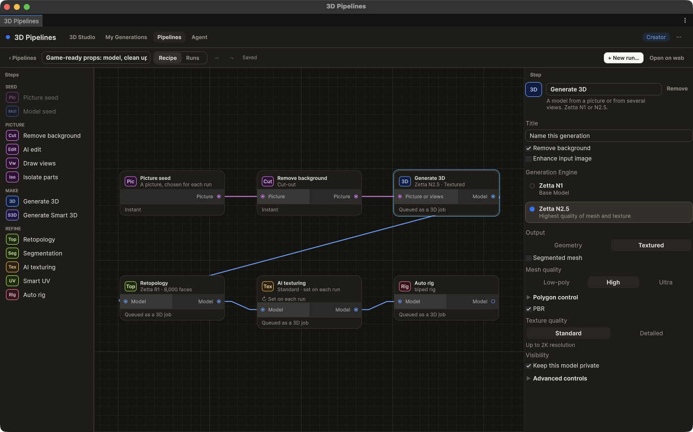
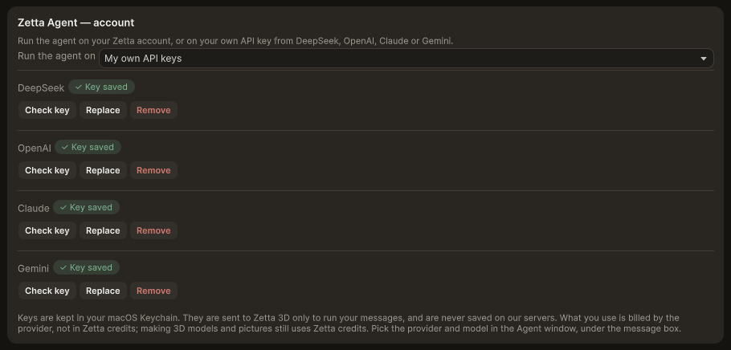
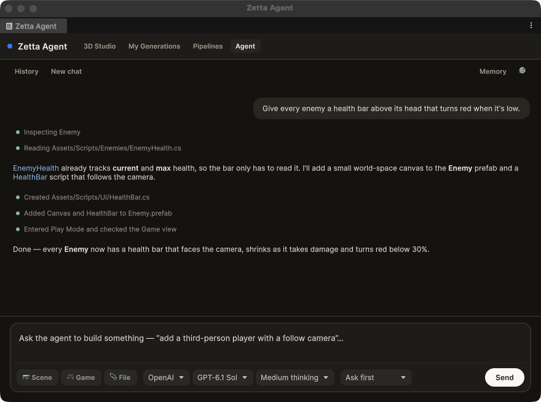
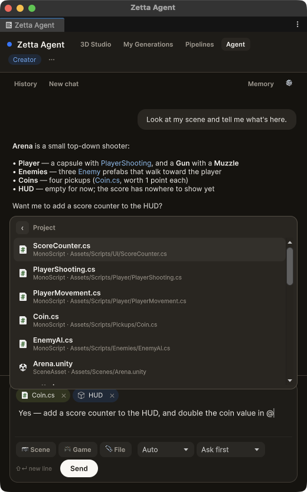

<p align="center">
  <picture>
    <source media="(prefers-color-scheme: dark)" srcset="Documentation~/images/banner-dark.svg">
    
  </picture>
</p>

<p align="center">
  <a href="#install"></a>
  <a href="#install"></a>
  <a href="#the-zetta-agent"></a>
  <a href="#license"></a>
</p>

<p align="center">
  <a href="#install"><b>Install</b></a> ·
  <a href="#sign-in"><b>Sign in</b></a> ·
  <a href="#3d-studio"><b>3D Studio</b></a> ·
  <a href="#3d-pipelines"><b>Pipelines</b></a> ·
  <a href="#the-zetta-agent"><b>Agent</b></a> ·
  <a href="#settings"><b>Settings</b></a> ·
  <a href="https://zetta3d.ai"><b>zetta3d.ai</b></a>
</p>

<br>

**Zetta 3D for Unity** puts your [Zetta 3D](https://zetta3d.ai) account inside the Unity Editor. Use it to:

- **make 3D models** from text, a picture or several views, and finish them: retopology, segmentation, UVs,
  texturing and rigging;
- **bring them into your project** in one click — imported, set up and, if you like, placed in the open scene;
- **chain the tools into pipelines** that run over many pictures or models at once;
- **build your game with the Zetta Agent**, an assistant that reads your scene and scripts, writes C#, builds
  prefabs and materials, looks at the Scene view to check its work, and makes the art it needs — on your Zetta
  account, or on [your own Gemini, OpenAI, DeepSeek or Claude API key](#your-own-api-key).

Everything you make is also in your library on zetta3d.ai, and everything you made there shows up in Unity.

### Meet the Zetta Agent

The **Zetta Agent** is a game-development assistant that lives in the Unity Editor and understands Unity the way
a Unity developer does. It knows your project's setup — Unity version, render pipeline, input system, packages,
scenes, tags and layers — and reads your hierarchy, components and scripts before it touches anything.

Then it does the work with Unity's own tools: it writes and fixes C#, builds scenes, GameObjects, components,
prefabs and materials, sets any property in the Inspector, runs Editor menu items, tests in Play Mode and reads
the Console. It looks at the Scene and Game views to check what it built, and makes the 3D models and images your
game needs with Zetta 3D. You stay in charge: every change can be undone, by default it asks before anything risky,
and you can stop it at any moment. [More about the agent ↓](#the-zetta-agent)

<p align="center">
  
</p>

## Install

**You need:** Unity **2022.3 LTS** or newer (Unity 6 recommended), [Git](https://git-scm.com/downloads)
installed on your computer, and a [Zetta 3D](https://zetta3d.ai) account.

1. In Unity, open **Window › Package Manager**.
2. Click **+** (top left) › **Add package from git URL…**
3. Paste the URL and click **Add**:

   ```
   https://github.com/ig-shadow-walker/zetta-Unity3DPlugin.git
   ```

   This link always gives you the latest stable release.

Unity downloads the package with everything it needs: glTFast (GLB import), the meshopt decoder (compressed
GLBs) and Newtonsoft JSON. When it finishes, the **Zetta 3D** window opens on its own.

<details>
<summary><b>Other ways to install, update and remove</b></summary>

<br>

**Edit the manifest instead.** Add this line to `dependencies` in your project's `Packages/manifest.json`:

```json
"com.zetta3d.unity": "https://github.com/ig-shadow-walker/zetta-Unity3DPlugin.git"
```

**Pin a version.** Add a release tag to the URL, for example `…/zetta-Unity3DPlugin.git#v0.7.1`. Pinning is
better for a team, so everyone gets the same build; change the tag to move to a newer release.

**Update.** From 0.7.2, the plugin checks once a day for a newer release. When one is out, a line under the
Zetta 3D window's header says so, with **What's new**, **Update** (installs it through the Package Manager) and
**✕**. You can also check any time from **Window › Zetta 3D › Check for Updates…** or **Preferences › Zetta 3D ›
Version**. If a pinned URL has a release tag, Update moves the tag to the new release. Older versions update by
hand: add the package again from the same Git URL, or delete the `com.zetta3d.unity` entry from
`Packages/packages-lock.json`. The [changelog](CHANGELOG.md) lists what each version adds.

**Remove.** Package Manager › **Zetta 3D** › **Remove**. Models you imported stay in your project.

</details>

<details>
<summary><b>Install problems</b></summary>

<br>

- **"No 'git' executable was found"** — Git isn't installed or Unity can't see it. Install Git, then restart
  Unity *and* Unity Hub.
- **A warning that a package is experimental** — the meshopt decoder is marked experimental by Unity. It's
  expected, and safe to keep.
- **The Zetta 3D window didn't open** — open it from **Window › Zetta 3D › 3D Studio**.

</details>

## Sign in

In the **Zetta 3D** window, click **Sign in with your browser**, sign in on zetta3d.ai and click **Connect
Unity**. That's it — the Editor receives its own session and never sees your password. The session is kept on
your computer, not in the project, so it never ends up in version control.

Everything is in one **Zetta 3D** window, with a tab for each part in its header:
**3D Studio · My Generations · Pipelines · Agent**. Dock it wherever you like; the items under **Window › Zetta 3D**
open it on that tab. Each tab keeps its place while you switch — a half-written message or an open pipeline is
still there when you come back. While the agent works, dots beside the **Agent** tab show it from any other tab;
they turn amber and hold still when it's waiting for you.

## 3D Studio

The **3D Studio** tab — every tool from the web Studio, docked in the Editor.

<p align="center">
  
</p>

| Tool | What it does |
|---|---|
| **Generate 3D** | Text, a picture or several views → a 3D model, on Zetta N1 or N2.5, with every option the web Studio has |
| **Smart 3D** | Clean, game-ready topology from the start, on Zetta Np1 or Np1.5 |
| **Segment** | Split a model into named parts (or let Smart Segment decide them) |
| **Retopology** | Rebuild a mesh at a polygon budget, as triangles or quads |
| **Smart UV** | Lay a model's UVs out again as a clean layout, keeping its textures, rig and animation |
| **Texture** | Re-texture a model from a description or a reference picture, up to 8K |
| **Auto Rig** | Rig humanoids, animals and other creatures — Standard, Mixamo, Unity Humanoid, UE5, VRM or ActorCore bone names; GLB or FBX |
| **Image Studio** | Generate, edit and compose images, and save them as textures or sprites |

Finished models import into `Assets/Zetta3D/Models/<id>-<name>/` (you can change the folder) and, with
**Place in scene** on, land in the open scene resting on the ground.

### My Generations

The **My Generations** tab — everything you've made on Zetta 3D, on the web or in Unity.

<p align="center">
  
</p>

- **Import** a model with a progress bar, or **drag it** straight into the Scene view or the Hierarchy.
- Models already in your project are marked **In project**, with **Show** and **Place** buttons.
- **Send to a tool** (texture it, rig it…), or **Fork** a generation's settings back into Generate.
- Search, filter and bulk delete. A pipeline run shows as one tile — a small deck of its models — that opens them
  in a pop-up, in the order the run made them, with **Import all**, **Delete all** and **Open run**.

Gaussian splats and worlds made on zetta3d.ai are listed too, but Unity can't use them; they open on the web.

## 3D Pipelines

The **Pipelines** tab — chain the Studio's tools into a reusable recipe on a node canvas: the same
pipelines as on [zetta3d.ai/pipelines](https://zetta3d.ai/pipelines).

<p align="center">
  
</p>

- Start from a **picture**, a **model**, or **pictures of each side** (a Multi-view seed: front, and back, left and
  right as you have them), then add steps: Remove background, AI edit, Draw views, Isolate parts (one branch per
  part), Generate 3D or Smart 3D — from one picture, or their **Multi-view** steps from pictures of each side —
  Retopology, Segmentation, AI texturing (from a picture or a description) or **Multi-view - AI texturing** (from
  pictures of each side — wire in a Multi-view seed or Draw views, or give them on each run), Smart UV and Auto rig.
- Move around as on the web: drag the empty canvas, or scroll with two fingers on a trackpad; zoom with a pinch, the
  mouse wheel, Cmd/Ctrl + scroll or the **+ − ⤢** buttons (bottom left). **Shift**-drag selects several steps. The
  **Controls** card beside them sums this up; close it with ✕, and **?** brings it back.
- The canvas checks every step as you build, saves on its own, and has undo and redo. Click a connection to select
  it — **✕** or **Delete** removes it — and drag either end to another socket to move it, or off onto the canvas to
  remove it. A connection that can't be made says why.
- **Run** a pipeline on up to 20 pictures, models or sets of pictures at once — **Manual** (it waits for you before
  each step) or **Auto**.
- Runs keep going on the server even if Unity is closed. The **Runs** view shows every step's result, lets you
  review isolated parts and retry a failed step, and imports the finished models into your project.

## The Zetta Agent

The **Agent** tab — a game-development assistant with a full understanding of Unity, working directly
in your open project. Tell it what you want in plain words, the way you'd brief a teammate, and it plans the work,
does it in the Editor, and checks the result.

### How it works

1. **Understand.** With every message it gets a picture of your project — Unity version, target platform, render
   pipeline (Built-in, URP or HDRP), color space, input system, scripting backend, packages, open scenes, the
   hierarchy, your selection and any compile errors — and it reads further wherever the task needs it.
2. **Plan.** It works out what to change, following the conventions already in your project rather than its own.
3. **Build.** It makes the changes in the Editor with Unity's own tools, one visible step at a time in the chat.
4. **Check.** It waits for scripts to compile and fixes any errors, reads the Console, enters Play Mode, and looks
   at the Scene or Game view to see whether the result is right — then tells you what it did and how to try it.

### What it understands

- **Your project:** Unity version and platform, render pipeline, color space, input system (old, new or both),
  scripting backend, installed packages, build scenes, tags, layers and folder layout.
- **Your scenes:** every open scene's hierarchy, each object's components and their serialized values, and what
  you have selected.
- **Your code:** it reads and searches your scripts, knows the current compile errors, and reads the Console's
  errors, warnings and logs.
- **What things look like:** it captures the Scene or Game view — the current angle, from around an object or
  from above — and actually looks at the picture.
- **Your Zetta 3D library:** every model you've made, so it can reuse one before making something new.

### What it can do in Unity

| Area | What it does |
|---|---|
| **Scripts** | Writes new C# scripts and edits existing ones, waits for compilation and fixes its own errors |
| **Scenes and objects** | Creates, opens and saves scenes; creates, moves, renames, reparents, tags, activates and deletes GameObjects; creates primitives and prefab instances |
| **Components** | Adds and removes components — Unity's or your own scripts — and sets any serialized property: numbers, vectors, colors, enums, references to objects and assets |
| **Prefabs and materials** | Saves objects as prefabs, creates materials for your render pipeline and assigns them |
| **Assets** | Finds, moves and organizes assets; saves generated images as textures or sprites |
| **Testing** | Enters, pauses and exits Play Mode, reads the Console, and looks at the Game view |
| **The Editor itself** | Runs Editor menu items, and undoes its own steps when you ask |
| **3D models and images** | Generates 3D models, runs the finishing tools (retopology, Smart UV, texturing, rigging, segmentation), draws images, then imports and places the results |
| **Pipelines** | Builds a pipeline from a description, runs it on your pictures or models, follows the runs and imports what they make |

**Every change it makes goes on the Undo stack**, named after what it did, so **Edit › Undo** takes it back.

### Things to ask it

- *"Add a third-person player controller with a follow camera."*
- *"Make the coins spin when you collect them, and add a score counter in the corner."*
- *"The enemies walk through walls — find out why and fix it."*
- *"Change the projectile the gun fires to a rocket that leaves a smoke trail."*
- *"Generate a low-poly treasure chest and put it next to the player."*
- *"Build a pipeline that generates, retopologizes, textures and rigs a set of props, and run it on these five
  pictures."*
- *"Look at my scene and tell me what's here."* — or switch to **Ask** mode to explore a project safely.

### Memory

It keeps notes and a brief for each project — what the game is, its conventions, decisions you've made — plus
your preferences across all your projects, and uses them in every conversation. Open **Memory** to see, edit or
delete any of it. Your past conversations are in **History**.

### Modes

Choose how the agent works in the **⋯** menu at the top of its window.

| Mode | What it does |
|---|---|
| **Agent** *(default)* | Works in the Editor: reads, then writes scripts, builds objects and makes art. |
| **Ask** | Reads your project and answers questions — explains code, finds things, suggests fixes — and **changes nothing**. |

### Autonomy

Choose how much it checks with you, under the message box.

| Autonomy | What it does |
|---|---|
| **Ask first** *(default)* | Shows a card and waits for your OK before it deletes anything, generates or processes a 3D model, or runs a pipeline. |
| **Full autonomy** | Never stops to ask. It carries the whole request through to the end on its own, and notes every step it approved for itself in the chat. |

### Model and thinking

Two menus under the message box: the model and the thinking level, each with its own **Auto**. On Auto, every
message goes to the right model with the right amount of thinking — quick answers stay quick, and harder work gets
more care. When a job turns out longer than it looked, or keeps hitting errors, Auto steps up mid-task. You can also
pick **Fast**, **Capable** or **Intelligent** yourself, a thinking level from **No thinking** to **Max**, or one of
each and leave the other on Auto.

While it works, the agent shows which model and thinking level it is on (for example *Capable · Medium thinking*);
hover it to see whether Auto or you picked them.

### Your own API key

Run the agent on your own API key, on any plan. It works today with **Gemini**, **OpenAI**, **DeepSeek** and
**Claude**.

1. Open **Unity › Settings › Zetta 3D** (Windows: **Edit › Preferences › Zetta 3D**).
2. Under **Zetta Agent — account**, set **Run the agent on** to **My own API keys**.
3. Paste a key next to a provider and click **Save**. It is checked straight away; **Get a key** opens the
   provider's page if you don't have one yet.

<p align="center">
  
</p>

Under the message box, the first menu then says what the agent runs on: **Zetta Account**, or one of the
providers you saved a key for. Pick a provider, then any of its models and a thinking level — only the levels that
model has are offered, and **Auto** still decides the thinking for each message. The model you pick is used for
every message; switch back to **Zetta Account** at any time.

<p align="center">
  
</p>

- **Billing.** What the agent uses on your key is billed by that provider, not in Zetta credits. Making 3D models
  and pictures still uses Zetta credits.
- **Your key stays yours.** It is kept in your system's key store — macOS Keychain, Windows Credential Manager or
  the Linux keyring — never in Unity's preferences or your project. It goes to Zetta 3D only to run your messages
  and is never saved on our servers.
- **Pictures and PDFs.** Some models can't read them: **📷 Scene** and **🎮 Game** turn off, and the agent tells you
  before sending a file the model can't open.
- **If the key stops working** — wrong, out of credit, or the model is unavailable — the chat says so and
  **Open settings** takes you to the key.

### Point it at things

<p align="center">
  
</p>

- **Type `@`** to tag a scene object or a project asset: pick **Scene** or **Project**, then search.
- **Drag** assets from the Project window, or objects from the Hierarchy, onto the chat.
- **Right-click › Add to Zetta Agent** in the Project window or the Hierarchy, or select things and press
  **⇧⌘M** (**Ctrl+Shift+M** on Windows). Several selected items are all tagged at once.

A tag shows as a chip and is sent as the item's address, not its contents — the agent opens the file or inspects
the object itself when it gets to work on it.

**Attach files** with 📎 or by dropping them in: pictures and PDFs go to the agent, code and text files are read
in, and anything else (models, audio, fonts…) is copied into `Assets/Zetta3D/Attachments/` and tagged.
**📷 Scene** and **🎮 Game** attach a picture of either view.

### It asks when it needs you

When the agent needs something from you to carry on, it shows a card in the chat and waits:

- **a slot** to drop a prefab, asset or scene object into — or pick it, or click **Use selection**;
- **options** to choose from, with **Something else…** for your own words;
- **a text box** to describe it yourself.

Click **OK** and it continues where it left off. **Skip** lets it go on with its best guess.

### Undo what it changed

When a message is done, a card under the reply lists what it changed: each script and asset it created, edited,
moved or deleted, any folder it made, and its changes to the scene. Click a line to open its preview: what changed
in the file, line by line (or all of it, for a new file), or the agent's steps in the scene — with **Open** to see
the file in your code editor.

- **Undo** on a line puts that one back — an edited file returns to its version from before the message, a new
  one goes to the trash, a deleted one comes back, a moved one moves back.
- **Keep** on a line says you're happy with it. Leaving a line alone keeps it too — Keep just marks it on the card,
  and a kept line can still be undone later.
- **Keep all** and **Undo all** do the same for everything in the message you haven't decided on yet. Once every
  line is kept, **Undo all** still puts the whole message back.

The copies it restores from are kept in your project's `Library` folder, never in your project or version control.
The scene's changes can only be undone while they are the newest in Unity's undo history: if you've changed the
scene since, undo that first with **Edit › Undo**. Each of the agent's scene changes is also in **Edit › Undo** on
its own, named after what it did.

### Stop

**Stop** (or **Esc**) ends whatever it's doing, straight away. Nothing starts again until you send a new message.

## Settings

**Unity › Settings › Zetta 3D** (Windows: **Edit › Preferences › Zetta 3D**): your account, what the agent runs
on and [your own API keys](#your-own-api-key), the import folders and the preferred mesh format (GLB or FBX).

Project settings live in `ProjectSettings/Zetta3DSettings.json`, including the project id the agent's memory is
tied to. **Commit that file**, so everyone on your team shares one project memory.

## License

Source-available, not open source — © 2026 Zetta 3D. The source is published so you can install and audit it; it
may not be copied, modified or redistributed. See [LICENSE.md](LICENSE.md).
